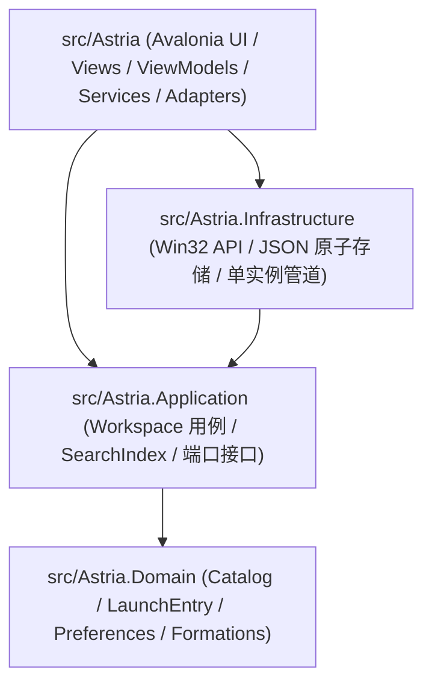

# 星屿 Astria

**星屿 (Astria)** 是一款面向 Windows 11 的桌面应用启动器与工作台管理程序，基于 **.NET 10** 与 **Avalonia 11** 构建。项目将星空浮动 Dock、工作台应用库管理、中英文/拼音/首字母即时检索、应用分组与系统级桌面集成整合在单一轻量桌面进程中，并采用清晰的四层架构（UI / Application / Domain / Infrastructure）保障数据安全与可测试性。

---

## 核心特性

### 1. 星环浮动 Dock (`DockWindow`)
- **三种编队形态**：支持 `orbits`（星轨双环）、`galaxy`（双旋臂星系）和 `matrix`（矩阵网格）三种卡片布局，支持旋转、浮动动效、自由拖拽定位与卡片缩放（`0.75x` – `1.30x`）。
- **高密度分页与分区**：单页可配置显示 `1`–`24` 个常用项；包含左侧系统/文件夹快捷区（如「此电脑」「回收站」）、中央即时搜索框与底部功能栏。
- **智能启动与窗口调度**：点击已运行应用时自动激活已有窗口；若处于前台则再次点击可最小化；多窗口应用弹出窗口选择菜单。

### 2. 应用库管理与工作台 (`WorkspaceWindow`)
- **分页网格与拖拽**：每页固定 21 个槽位，支持拖入 `.exe`、`.lnk` 快捷方式、文件与文件夹，支持跨页拖拽排序与位置互换。
- **应用文件夹（分组）**：合并两个应用创建分组，支持组内排序、移出成员、重命名与解散分组。
- **开始菜单扫描与自定义编辑**：内置开始菜单应用扫描导入；支持重命名（1–80 字符）、自定义搜索别名、自定义图标（自动拷贝至数据目录 `icons/` 持久化）。
- **离线中文拼音检索**：基于内置 Unicode 17.0.0 Unihan 拼音字典（`mandarin.tsv`），支持按名称、完整拼音、拼音首字母及搜索别名即时过滤。

### 3. Windows 桌面深度集成
- **全局热键**：默认 `Ctrl + Alt + Space` 呼出/隐藏 Dock，`Ctrl + Alt + S` 呼出/隐藏设置，支持防冲突录制与安全热替换（禁止保留键 `F12`）。
- **桌面图标显隐控制**：一键切换 Windows 桌面图标（`Progman`/`WorkerW` → `SysListView32`）显示状态，支持启动时自动隐藏并在退出时按需还原。
- **运行状态追踪**：后台定时枚举 Win32 可见窗口、识别 DWM Cloaked 状态与进程路径/AUMID，支持 UWP/`WindowsApps` 版本升级后的包家族自动匹配，以及可选的后台进程追踪。
- **单实例与系统托盘**：按用户会话与数据目录派生命名互斥量和命名管道（`InstanceChannel`），支持托盘菜单与 Explorer 重启后的托盘图标自动重挂（`TaskbarCreated`）。

---

## 项目架构

解决方案 [`Astria.slnx`](Astria.slnx) 包含 4 个源码项目与 1 个测试项目，仅生成唯一可执行程序 `Astria.exe`：



| 模块路径 | 编译产物 | 职责边界 |
| --- | --- | --- |
| [`src/Astria`](src/Astria) | `Astria.exe` | 唯一程序入口；保留原有 Avalonia 视图、样式、卡片动效与托盘交互，通过 `DesktopController`、`DesktopSession` 与 `Adapters` 对接底层 |
| [`src/Astria.Application`](src/Astria.Application) | `Astria.Application.dll` | 编排应用导入、去重、搜索（`SearchIndex`）、排序、分组、备份恢复与启动激活流程（`Workspace`） |
| [`src/Astria.Domain`](src/Astria.Domain) | `Astria.Domain.dll` | 定义不可变领域模型（`Catalog`、`LaunchEntry`、`Preferences`、`KeyChord`）、数据归一化校验与分页/编队几何规则 |
| [`src/Astria.Infrastructure`](src/Astria.Infrastructure) | `Astria.Infrastructure.dll` | 实现 `CatalogStorage` 原子文件持久化、旧版数据迁移、Win32 热键/桌面图标/窗口控制、开始菜单与图标提取、单实例 IPC |
| [`tests/Astria.Tests`](tests/Astria.Tests) | `Astria.Tests.dll` | 覆盖领域不变量、应用层用例、存储容错、Avalonia Headless UI 渲染回归与真实进程冒烟测试 |

> **UI 基线保护**：[`UI-BASELINE.json`](UI-BASELINE.json) 记录了 23 个核心 UI、样式、动效与资源文件的 SHA-256 哈希，由自动化测试逐字节校验，确保底层架构演进不破坏既有界面与交互体验。

---

## 环境要求与构建运行

- **操作系统**：Windows 11 x64（目标框架 `net10.0-windows10.0.26100.0`）
- **开发工具**：.NET SDK `10.0.401`（见 [`global.json`](global.json)），Avalonia `11.3.22`

### 常用命令

```powershell
# 编译解决方案（Release）
dotnet build Astria.slnx -c Release

# 运行全部单元、Headless UI 与冒烟测试
dotnet test Astria.slnx -c Release

# 启动桌面端程序
dotnet run --project src/Astria/Astria.csproj -c Release

# 或使用构建脚本一键执行编译 + 测试
./build/build.ps1

# 发布包含 .NET 10 运行时的自包含便携版（输出至 artifacts/win-x64）
./build/publish.ps1
```

> 如需发布框架依赖版（Framework-Dependent），可执行 `./build/publish.ps1 -FrameworkDependent`。分发自包含便携版时请保留整个 `artifacts/win-x64` 目录。

---

## 命令行参数与快捷键

### 命令行参数

| 参数 | 说明 |
| --- | --- |
| `--data-root <目录>` | 指定独立的数据存储目录（支持多环境隔离运行与调试） |
| `--settings` | 启动或唤醒当前数据目录实例并直接打开「设置」页 |
| `--autostart` | 静默后台启动（不主动弹出主界面，用于开机自启） |
| `--exit` | 向同一数据目录正在运行的实例发送退出指令并关闭 |

> 注：`--settings`、`--autostart`、`--exit` 三个启动模式参数互斥，不可同时组合使用。

### 默认快捷键

| 快捷键 | 功能 |
| --- | --- |
| `Ctrl + Alt + Space` | 呼出 / 隐藏星环 Dock（已激活时再次按下收起） |
| `Ctrl + Alt + S` | 呼出 / 隐藏管理台设置页（已激活时再次按下收起） |

---

## 数据存储、迁移与备份

- **默认数据路径**：`%LOCALAPPDATA%\Astria\Data\catalog.json`（自定义图标保存在同级 `icons/`，自动快照保存在 `backups/`）。
- **原子写入与损坏保护**：`Workspace` 采用“先归一化校验并落盘、成功后再替换内存状态”的提交策略；`CatalogStorage` 使用同目录临时文件与 `File.Replace` 原子替换（保留 `.bak`）。当遇到损坏 JSON 或更高 `SchemaVersion` 时拒绝静默覆盖，保护用户原有数据文件。
- **无损旧版自动迁移**：默认数据目录首次无 `catalog.json` 时，若检测到 `%LOCALAPPDATA%\GlassDesk.Avalonia\Data\apps.json`，将自动只读导入旧版应用库、固定项、分组布局与外观设置，原目录保持不变。
- **备份与恢复**：「设置 → 恢复备份」同时兼容本版快照目录与包含 `apps.json` 的旧版数据目录；每次恢复或清空应用库前均自动创建安全备份，且移除/清空操作仅删除启动器条目，绝不删除磁盘上的目标程序或文件。

---

## 文档导航与版权说明

- **阅读导航**：
  1. [项目架构入门说明](docs/ARCHITECTURE-BEGINNER.md) — 从零理解四层职责、启动生命周期与核心数据流
  2. [架构与界面保留边界](docs/ARCHITECTURE.md) — 依赖方向、适配层设计与状态持久化策略
  3. [来源与验证说明](docs/IMPLEMENTATION.md) — 代码复用边界、Unicode 数据来源与测试验证覆盖范围
  4. [第三方组件与许可声明](THIRD-PARTY.md) — Avalonia、SkiaSharp、HarfBuzzSharp、.NET Runtime 与 Unicode 许可信息
- **作者与版权**：
  - 作者：**WonilNam**（详见 [AUTHORS.md](AUTHORS.md)）
  - 版权声明：Copyright © 2026 WonilNam. All rights reserved.（详见 [COPYRIGHT.md](COPYRIGHT.md)）
