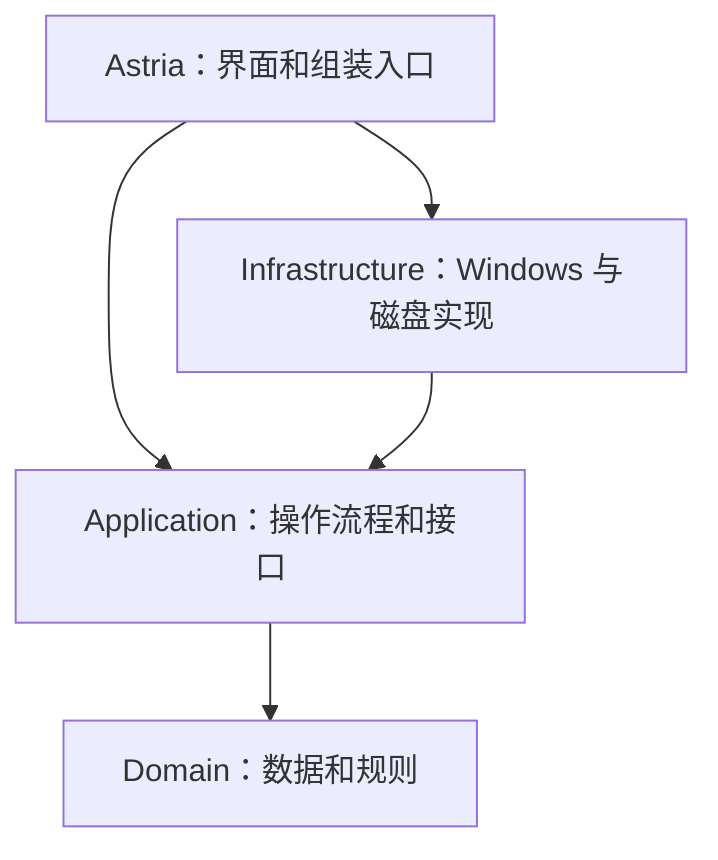

# 星屿 Astria：从零读懂整个项目

作者：WonilNam

## 1. 它到底是什么

Astria 是一个 Windows 桌面启动器。你把应用、文件、文件夹等入口放进去，再通过浮动卡片、搜索或快捷键打开它们。它还负责常用项、分组、主题、桌面图标显示和托盘菜单。

项目使用 C#、.NET 10 和 Avalonia。Avalonia 负责画窗口、按钮和卡片；Windows API 负责系统快捷键、托盘、窗口激活等系统能力。这里没有网站服务器，也没有数据库服务器；主要配置写在本机 JSON 文件里。

## 2. 四个项目，是一个程序的四部分

可以把程序想成一家餐厅：界面是前台，应用层负责安排任务，领域层保存规则，基础设施负责真正接触外部设备。拆开是为了修改一部分时更容易判断会影响哪里。

| 项目目录 | 它负责什么 | 直观例子 | 编译结果 |
| --- | --- | --- | --- |
| src/Astria | 显示界面、接收操作、组装整个程序 | 卡片怎么画、拖拽怎么反馈 | Astria.exe 入口及对应程序集 |
| src/Astria.Application | 把用户操作组织成完整任务 | 导入、搜索、排序、备份 | Astria.Application.dll |
| src/Astria.Domain | 定义数据与规则 | 一个入口有什么字段、常用状态和分组 | Astria.Domain.dll |
| src/Astria.Infrastructure | 操作 Windows 和磁盘 | 保存 JSON、读快捷方式、激活窗口 | Astria.Infrastructure.dll |

DLL 是供主程序调用的代码。你只需要启动 Astria.exe，不需要分别启动四个项目。界面里保留的 Astria.Desktop 命名空间只是代码分类名称，不是第二套程序。

## 3. 它们如何连接

下面画的是“代码引用谁”，不是按钮被点击后的执行顺序。箭头 A → B 表示 A 可以调用 B 的类型。



Application 定义“我需要一个能保存数据的对象”这个接口 ICatalogStorage；Infrastructure 的 CatalogStorage 实现它。这样应用层不必知道磁盘文件怎么写。界面的 DesktopController、DesktopSession 把这些对象连接起来。

这套结构没有额外加入消息总线、数据库或通用仓储，当前规模用构造参数和接口即可。代价是文件分散在几个目录；收益是系统 API、界面效果和业务规则的修改边界更清晰。

## 4. 启动时发生什么

1. Program.cs 进入程序，初始化 Avalonia。
2. App.axaml.cs 加载主题，读取命令行和数据目录，建立单实例通信。
3. DesktopSession 读取应用库；DesktopController 创建窗口、托盘、快捷键等对象。
4. 根据启动参数显示 Dock、设置，或者在后台等待。
5. 后续由点击、键盘、拖拽、定时刷新驱动程序。退出时释放快捷键、托盘和通信资源。

重复运行同一数据目录的程序，会通知已有实例，而不是再打开一套独立应用库。测试或调试可以用 --data-root 指定另一个数据目录。

## 5. 用三个操作理解数据怎么流动

### 把一个应用拖进去

管理窗口收到拖入的路径 → DesktopSession 转交导入任务 → Workspace 调用系统接口解析路径 → WindowsLauncher 识别程序、快捷方式或文件夹 → 生成 LaunchEntry → 保存 Catalog → 刷新界面。

路径是“要打开什么”，图标是“显示什么”，名称和搜索别名是“怎么找到它”。添加入口不会复制整个应用安装目录。

### 把应用设为常用

界面发出修改 → Workspace 生成修改后的候选数据 → CatalogStorage 保存成功 → Workspace 替换当前数据并通知变化 → 界面重新取数据。先保存再更新内存，可避免保存失败时界面已经表现为成功。

### 点击卡片启动应用

卡片 → DesktopController / DesktopSession → 应用层启动流程 → WindowsLauncher 查找匹配窗口并激活，或打开目标。运行标记由后台刷新和身份匹配提供，不能仅凭应用显示名称判断；快捷方式、应用包和后台进程会增加识别复杂度。

## 6. 去哪里找你要改的功能

| 要改什么 | 优先阅读 |
| --- | --- |
| Dock 卡片、搜索、分页和交互 | src/Astria/Views/DockWindow.axaml 及 .cs |
| 卡片编队形状 | src/Astria/Services/ConstellationLayout.cs |
| 浮动与旋转 | src/Astria/Services/OrbitMotion.cs、Views/StarRingScene.cs |
| 管理页和设置页 | src/Astria/Views/WorkspaceWindow.axaml 及 .cs |
| 管理页拖拽排序 | src/Astria/Views/WorkspaceWindow.Drag.cs |
| 主题与颜色 | src/Astria/Styles/Theme.axaml、Services/DesktopPalette.cs |
| 界面需要显示的数据 | src/Astria/ViewModels/WorkspaceViewModel.cs、AppTile.cs |
| 界面与新底层怎么对接 | src/Astria/Services/DesktopSession.cs、Adapters/ |
| 导入、排序、分组和常用规则 | src/Astria.Application/Workspace.cs |
| 拼音、首字母和别名搜索 | src/Astria.Application/SearchIndex.cs |
| 应用数据结构 | src/Astria.Domain/Model.cs |
| 保存、加载和损坏文件处理 | src/Astria.Infrastructure/CatalogStorage.cs |
| 快捷键、桌面图标和登录启动 | src/Astria.Infrastructure/DesktopIntegration.cs |
| 运行窗口识别与打开程序 | src/Astria.Infrastructure/WindowsLauncher.cs |
| 托盘系统接口 | src/Astria.Infrastructure/NotificationArea.cs |
| 项目作者和版权 | AUTHORS.md、COPYRIGHT.md、Directory.Build.props |

注意：Domain/Formations.cs 中还有底层几何实现，但当前保留的 Dock UI 使用 ConstellationLayout.cs。修改前要沿实际调用查找，不能只看文件名。

## 7. 数据在哪里，源码又在哪里

源码是项目里的 .cs、.axaml 和资源文件。日常添加的应用及个人设置是运行数据，默认放在：

```text
%LOCALAPPDATA%\Astria\Data\catalog.json
```

Catalog 是整份应用库；LaunchEntry 是其中一个入口；Preferences 是设置。原有界面的完整外观参数通过 presentationJson 保存。自定义图标存放在数据目录的 icons 下。

修改设置后由保存逻辑写盘，下次启动重新读取，因此正常保存的设置可以跨重启保留。默认目录首次初始化时也有旧数据导入逻辑，详情见 README。清空应用库只移除启动入口，不删除它们指向的文件。

备份和恢复在 DesktopTransferService.cs 中对接。恢复前生成安全副本；发布源码时不要把自己的 Data 目录一起上传。

## 8. 为什么还要有适配器

原有界面有自己的 AppEntry 等数据格式，新底层用 LaunchEntry。Adapters 和 DesktopSession 像翻译，把两种格式接起来，让原界面继续使用。

这样可以保留原卡片、主题和交互，不必因为底层拆层就重画界面。代价是多一层映射。部分兼容命名空间沿用旧名字，但不代表存在第二套旧程序集依赖。

UI-BASELINE.json 记录 23 个保留界面文件的哈希。哈希像文件指纹，测试会检测这些文件是否发生变化。以后确实要改其中的界面，应在确认变更后同步基线；不应该为绕过测试随便重写基线。

## 9. 如何运行、测试、打包

开发需要 Windows 11 x64 和项目指定的 .NET SDK。终端进入项目根目录：

```powershell
dotnet build Astria.slnx -c Release
dotnet test Astria.slnx -c Release
dotnet run --project src/Astria/Astria.csproj -c Release
./build/publish.ps1
```

build 检查并编译代码；test 运行自动化验证；run 启动开发版本；publish 生成可分发版本。默认发布目录是 artifacts/win-x64，其中包含运行时，分发时要保留整个目录，不能只拿 Astria.exe。

测试分为数据规则、应用流程、存储、无头界面和真实进程冒烟测试。无头界面测试能验证控件和部分布局，但仍需要手动观察动画、拖拽、多屏和 DPI 表现。

## 10. 后续修改的简单方法

先定位功能所在文件，确认界面操作经过哪些服务；再修改对应规则或实现；运行相关测试和全套检查；最后启动程序实际操作。修改主题不需要重写存储，修改保存不需要重新设计卡片。

建议阅读顺序：README → 本文 → Domain/Model.cs → Application/Workspace.cs → Services/DesktopSession.cs → 你要改的具体窗口或系统实现。第一遍只理解每层负责什么，不必一次看完所有 Windows API。

## 11. 署名文件代表什么

AUTHORS.md 记录作者 WonilNam；COPYRIGHT.md 记录项目版权声明；Directory.Build.props 将作者、公司和版权信息写入编译元数据。第三方组件的声明独立保留。

本次添加的是项目版权声明，不是政府登记证书，也没有对 exe 做数字签名。如果以后决定开放复制、修改和分发权限，再由你选择相应的软件许可并添加 LICENSE。
